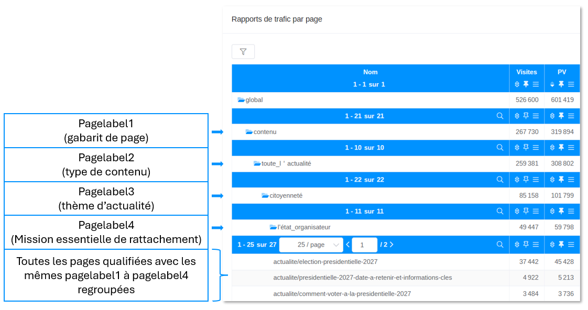
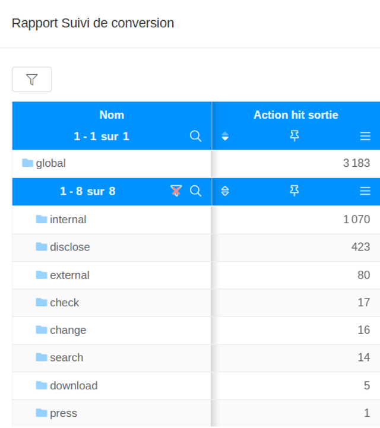
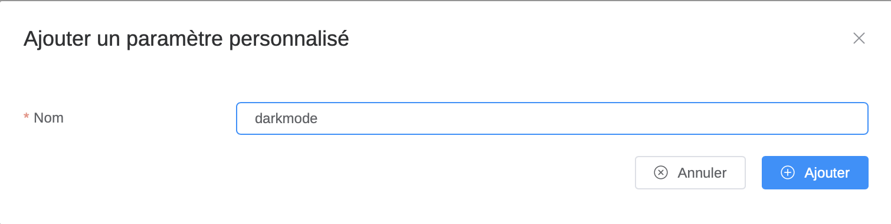
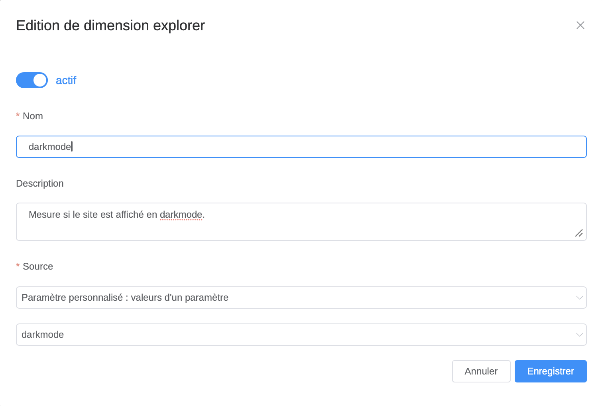
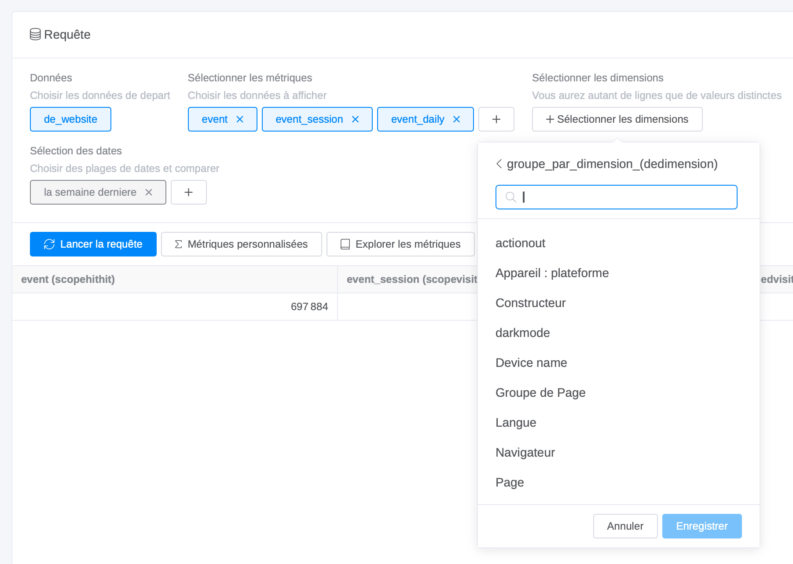
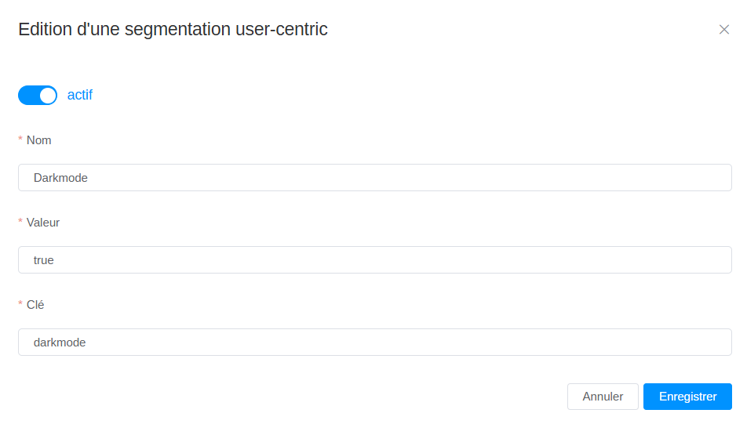
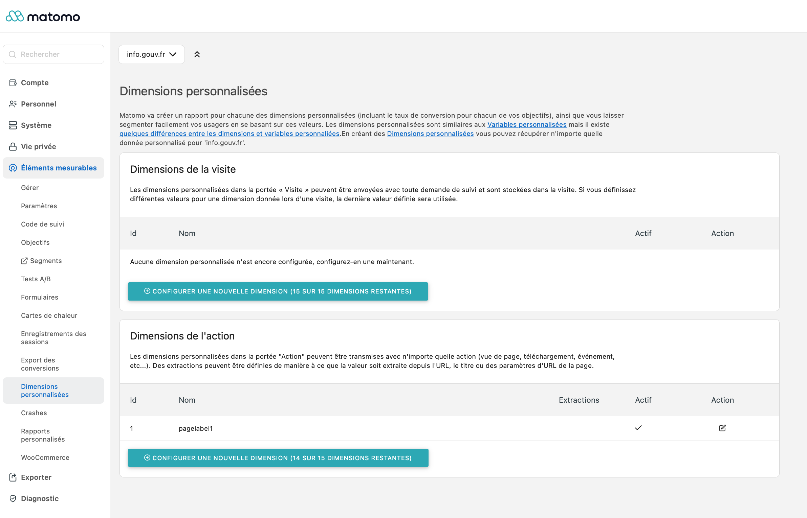

## Configurer la collecte de données analytics

### Étape 1 - Fournir les identifiants

Quelle que soit la solution retenue, certaines informations d’identification du site doivent être fournies lors de la configuration initiale. Elles sont disponibles auprès du communicant une fois le compte ouvert, ou directement dans l’interface de la solution.

- **Pour Eulerian** : le domaine de collecte, communiqué par Eulerian lors de l’intégration, il est également disponible directement dans l’interface de la solution de mesure. [Consultez la documentation technique associée](https://app.notion.com/p/Documentation-technique-3f3a79bef621807f9cb7d3244b5fcf96?pvs=21).
- **Pour Matomo On Premise** : l’URL de l’instance et l’ID du site sont disponibles dans l’interface d’administration. [Consultez la documentation technique associée](https://app.notion.com/p/Documentation-technique-3f3a79bef621807f9cb7d3244b5fcf96?pvs=21).

Ces informations doivent être transmises à l’équipe technique avant le démarrage de la configuration.

::::dsfr-doc-guidelines

:::dsfr-doc-guideline[✅ À faire]{col=6 valid=true}

- Transmettre ces identifiants à l’équipe technique dès l’ouverture du compte.
- Vérifier que les identifiants correspondent bien à l’environnement cible.

:::

:::dsfr-doc-guideline[❌ À ne pas faire]{col=6 valid=false}

- Ne pas laisser l’équipe technique démarrer la configuration sans ces informations : la collecte sera non fonctionnelle.

:::

::::

### Étape 2 - Adapter le déclenchement de la collecte à l’environnement technique du site

La propriété `collection` indique **à quel moment** les données d’une page sont envoyées vers la solution de mesure d’audience.

Ce réglage est surtout important pour les sites en **Single-Page Application (SPA)** :

- **Sur un site classique**, chaque nouvelle page se charge entièrement. L’envoi des données se fait donc automatiquement, sans réglage particulier.
- **Sur une SPA**, la page ne se recharge pas : seul son contenu change. Sans le bon réglage, les changements de page ne sont pas détectés, et 80 % des pages vues ou plus peuvent ne pas être comptabilisées.

**Comment savoir si un site est une SPA ?** Quand on navigue, l’adresse (URL) change, mais la page ne se recharge pas entièrement.

Il existe [quatre valeurs possibles de la propriété `collection` dans l’API Analytics](../../code/general/collector/index.md), pour vous assurer que les données sont collectées au bon moment.

::::dsfr-doc-guidelines

:::dsfr-doc-guideline[✅ À faire]{col=6 valid=true}

- S’assurer que l’équipe technique connaît le type d’architecture du site avant de démarrer la configuration (site en Single-Page Application).
- Demander à l’équipe technique de confirmer le mode de collecte retenu avec la propriété `collection` et  e documenter.
- Vérifier que les pages vues sont correctement comptabilisées avant la mise en production.

:::

:::dsfr-doc-guideline[❌ À ne pas faire]{col=6 valid=false}

- Ne pas mettre en production sans que l’équipe technique ait validé le bon déclenchement des pages vues.
- Ne pas supposer que la configuration par défaut de la propriété `collection` convient : vérifier selon l’architecture du site.

:::

::::

### Étape 3 - Définir le mode de suivi des interactions

Le **mode de suivi des interactions** permet de mesurer ce que font les utilisateurs sur la page (clics sur un bouton, ouverture d’un menu, etc.), **en plus des pages vues**. Par défaut, ce suivi est **désactivé**.

L’[API Analytics du DSFR propose trois niveaux](../../code/general/collector/index.md) de configuration, grâce à la propriété `isActionEnabled` :

- **Tout désactivé (par défaut)** : mesure seulement les pages vues, aucune action des utilisateurs.
- **Mode réduit (recommandé)** : mesure seulement les actions sur les éléments que l’on a choisis et marqués à l’avance.
- **Tout activé** : mesure toutes les actions sur tous les composants DSFR.

**Pourquoi choisir le mode réduit ?** Il évite de collecter des données inutiles, et il oblige à se demander dès le départ : qu’est-ce que je veux vraiment mesurer ?

>[!WARNING]
> Le mode “tout activé” peut générer un volume important de données collectées et **avoir un impact financier important**.
>
> Les interactions répétées sur un même élément ne sont pas toutes envoyées, une limitation à la première interaction a été prévue dans l’API Analytics pour éviter la surconsommation.

::::dsfr-doc-guidelines

:::dsfr-doc-guideline[✅ À faire]{col=6 valid=true}

- Définir en amont les interactions prioritaires à suivre, en lien avec les objectifs de la page.
- Privilégier le mode de suivi réduit pour un plan de marquage ciblé et exploitable.
- Associer chaque interaction à un objectif d’analyse avant de demander son implémentation.

:::

:::dsfr-doc-guideline[❌ À ne pas faire]{col=6 valid=false}

- Ne pas activer le suivi global par défaut sans avoir validé le besoin de suivre l’ensemble des actions des utilisateurs.
- Ne pas demander le suivi d’une interaction sans avoir validé le KPI permettant de mesurer, qu’il s’agisse d’une volume d’actions, d’un taux d’interaction ou d’un taux de conversion par exemple.

:::

::::

### Étape 4 - Capitaliser sur les dimensions natives de la solution (Eulerian seulement)

Eulerian peut voir ses rapports natifs enrichis grâce à l’utilisation de certaines dimensions natives à la plateforme. Ces dimensions natives ne requièrent aucune déclaration au préalable dans la plateforme mais doivent être alimentées dans le plan de marquage.

- **Pagelabel :** cette dimension permet de qualifier les pages de 5 manière différentes (pagelabel1 à pagelabel5), et enrichit **le rapport “traffic par page”** en proposant une segmentation des contenus. L’utilisation de cette dimension est fortement recommandée dès lors qu’il s’agit de qualifier de contenu (catégories de page, thèmes, gabarit, type de contenu, etc…)

*Exemple d’utilisation de pagelabel1 à pagelabel4 sur info.gouv*

- **ActionLabel** : cette dimension permet de qualifier les actions de 5 manière différentes (actionlabel1 à actionlabel5), et enrichit **le rapport “suivi de conversions”** en proposant une segmentation des actions. L’API Analytics prend en charge automatiquement les actionlabel  : [Suivi des actions sur les composants DSFR](../../code/general/actions/index.md)

*Exemples de valeurs pour Actionlabel1 permettant de regrouper les actions par type (redirection externe, affichage, lien sortant, téléchargement, etc..)*

>[!WARNING]
> Les `pagelabel` et `actionlabel` sont des dimensions permettant d’opérer des regroupements. **Ces dimensions ne sont pas prévues pour récupérer des centaines de valeurs différentes** (comme le nom de la page, ou le titre de la page par exemple). Si trop de valeurs différentes sont poussées dans ces dimensions, cela peut dégrader les performances de la solution.

### Étape 5 - Personnaliser le suivi des pages vues avec les dimensions personnalisées

#### Surcharger manuellement certaines données

Lorsque l’API Analytics charge le script de la solution de mesure, ce script capture automatiquement certaines données de la page, comme l’URL ou le titre. Ces données peuvent être surchargées manuellement, par exemple lorsque le titre de page est trop long ou ne correspond pas à la dénomination souhaitée dans l’outil de mesure.

#### Le rôle des dimensions personnalisées

Il est également possible d’ajouter des informations contextuelles supplémentaires sur les pages, grâce aux **dimensions personnalisées**. Ces dimensions personnalisées, **renseignées dans le plan de marquage,** enrichissent considérablement les analyses : quel type de contenu, quelle thématique, quelle rubrique, quel gabarit.

Il s’agit d’un attribut descriptif d’un hit, d’une visite ou d’un utilisateur, qui permet **de segmenter et de croiser les données.**

Ces dimensions personnalisées doivent être utilisées pour stocker **une liste finie de valeurs** (ex : liste de thématiques). Elles ne doivent pas être utilisées pour stocker des valeurs uniques par pages (ex : titre de l’article), **au risque de dégrader fortement les performances**.

Il est important de vérifier le fonctionnement de ces dimensions en fonction de la solution de mesure utilisée (Eulerian ou Matomo) car **elles impliquent une déclaration dans la plateforme avant d’être ajoutées par les développeurs** dans le script déployé sur le site.

#### Les deux types de dimensions : action et visite

Il existe deux types de dimensions à programmer dans la solution, **en fonction de la portée attendue** pour cette dimension :

- **Dimensions d’action** : Les dimensions de portée action sont associées à chaque appel de collecte et qualifient la page ou l’interaction consultée. Elles permettent d’analyser la performance page par page et de regrouper les pages partageant les mêmes caractéristiques éditoriales.
- **Dimensions de visite** : Les dimensions de portée visite qualifient l’ensemble d’une session de navigation. Elles ne sont pas attachées à une page spécifique mais à la visite dans sa globalité. Si plusieurs valeurs sont envoyées au cours d’une session, c’est la **dernière valeur reçue** qui est conservée.

::::fr-accordion[#### Gestion des dimensions personnalisées sur Eulerian]{id=dimension-eulerian}

**Eulerian propose 30 dimensions personnalisées maximum, qui sont toutes par défaut des dimensions de type “action”.**

:::fr-accordion[##### Pour créer une dimension personnalisée de type “action” sur Eulerian, il faut :]{id=dimension-action-eulerian}

- **Étape 1** : aller sur la page “Liste des paramètres personnalisés” et créer un nouveau paramètre personnalisé, qui sera ensuite disponible dans le data-mining et les rapports de conversion.    *Étape 1 : ajout d’un paramètre personnalisé*

>[!WARNING]
> Le nom du paramètre personnalisé doit correspondre exactement à [la dimension ajoutée dans la couche de données du tag Eulerian](../../code/eulerian/index.md).

- **Étape 2** : puis, aller dans “Dimension explorer” et ajouter le paramètre personnalisé précédemment créé, en le retrouvant dans le menu source “Paramètre personnalisé : valeurs d’un paramètre”. Grâce à cette étape 2, vous pouvez désormais avoir accès à votre dimension personnalisée sur la page “widget”, qui permet d’analyser plus finement votre site.    *Étape 2 : ajouter le paramètre personnalisé dans le Dimension Explorer*    *Pour retrouver votre dimension personnalisée sur les widgets, sélectionner “de_webiste” dans le premier filtre “Données”, puis “groupe_par_dimension_(dedimension)” dans le filtre “Dimensions”.*

:::

:::fr-accordion[##### Pour créer une dimension personnalisée de type “visite” sur Eulerian, il faut :]{id=dimension-visite-eulerian}

- **Étape 1** : aller sur la page “Liste des paramètres personnalisés” et créer un nouveau paramètre personnalisé, qui sera ensuite disponible dans le data-mining et les rapports de conversion (ex : `darkmode`).    *Étape 1 : ajout d’un paramètre personnalisé*

> [!WARNING]
> Le nom du paramètre personnalisé doit correspondre exactement à [la dimension ajoutée dans la couche de données du tag Eulerian](../../code/eulerian/index.md).

- **Étape 2** : aller sur la page “Clé de segmentation (subkey2)”, puis ajouter une segmentation “user centric” (ex `darkmode`).    *Étape 2 : création d’une clé de segmentation*

Voici ci-dessous une description des éléments attendus pour créer la clé de segmentation :

| Champ à renseigner | Description |
| --- | --- |
| **Nom** | Nom de l’univers affiché comme filtre dans les rapports Eulerian. |
| **Clé** | Nom de la propriété à mettre dans l’API Analytics. |
| **Valeur** | Valeur du paramètre transmise. |

Les clés de segmentation créées sont ensuite disponibles sur les rapports natifs et dans le report center comme des filtres ou segments dès qu’elles commencent à recevoir de la donnée.

:::

:::fr-card{horizontal=true col=12}

### [Documentation Eulerian sur le Report Center et les dimensions personnalisées](https://tableaudebordeulerian.fr/prerequis-du-report-center/)

:::

::::

::::fr-accordion[##### Gestion des dimensions personnalisées sur Matomo]{id=dimension-matomo}

**Matomo** propose par défaut 15 dimensions d’action et 15 dimensions de visite, pré-déclarées dans la solution de mesure d’audience.

**Pour créer une dimension personnalisée (de type visite ou action) sur Matomo, il faut :**

- **Étape 1** : Se rendre sur les règles, section “Éléments mesurables” puis “Dimensions personnalisées”
- **Étape 2** : Ajouter une dimension, soit de type action, soit de type visite.     *Interface de création de dimension personnalisée dans Matomo*

:::fr-card{horizontal=true col=12}

### [Documentation Matomo sur les dimensions personnalisées](https://fr.matomo.org/faq/reporting-tools/create-track-and-manage-custom-dimensions/)

:::

::::

#### Récapitulatif sur les dimensions personnalisées

::::dsfr-doc-guidelines

:::dsfr-doc-guideline[✅ À faire]{col=6 valid=true}

- Définir en amont un plan de qualification avec les équipes éditoriales.
- Normaliser les valeurs (minuscules, sans accents, sans espaces) et les documenter dans un référentiel partagé.
- Réévaluer régulièrement le plan de qualification pour l’adapter à l’évolution du site, en cas de création de nouveaux gabarits par exemple.
- Les dimensions personnalisées doivent faire l’objet d’une configuration préalable dans la solution de mesure d’audience (Eulerian ou Matomo).

:::

:::dsfr-doc-guideline[❌ À ne pas faire]{col=6 valid=false}

- Ne pas utiliser les dimensions pour stocker des valeurs uniques par page (titre, URL, identifiant d’article) : elles sont conçues pour regrouper, pas pour distinguer. **Un mauvais usage dégrade les performances.**
- Ne pas multiplier les dimensions sans réflexion : chaque dimension doit correspondre à un besoin d’analyse identifié.
- Ne pas supposer que la migration vers la v2 conserve automatiquement les dimensions v1 : chaque dimension doit être explicitement reconduite.
- Ne pas créer des dimensions personnalisées alimentées avec des données sensibles au sens RGPD

:::

::::
